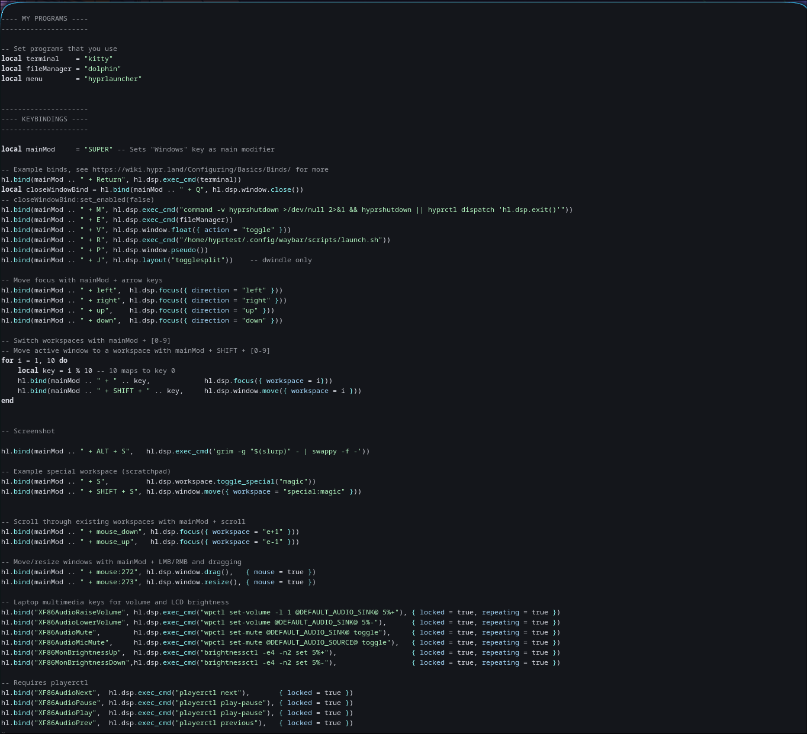

<h1>Hyprland-rice</h1>

<h2>Chose a ajouter</h2>

<ul>
  <li>Ajouter le module Network waybar</li>
  <li>Finaliser les workspaces/transitions</li>
  <li>Modifier et ajouter au demarage le fileManager dans la console <strong>sudo pacman -S yazi
</strong></li>
</ul>

<h2>Screen Waybar</h2>

<h2>Screen Config Files</h2>

